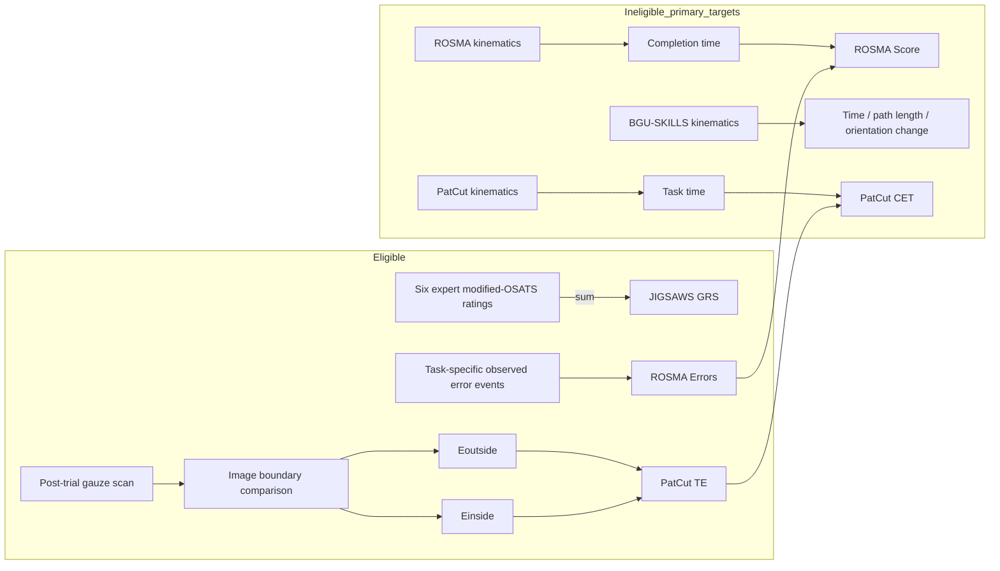

# Target provenance and circularity audit

## Verified formulas

- `JIGSAWS GRS = sum(six modified-OSATS element ratings)`, range 6–30,
  higher is better. Equality holds for all 103 usable local trials.
- `ROSMA Score = Time + penalty × Errors`, where penalty is 15 seconds for
  Post and Sleeve and Pea on a Peg, and 10 seconds for Wire Chaser I. Lower is
  better. The composite is not a primary target because time/duration is
  directly available from the input record.
- `BGU-PatCut TE = Eoutside + Einside`, measured from the post-trial gauze
  scan. Lower is better. The scan is independent of the dVRK kinematic stream.
- `BGU-PatCut CET = z(TT) + z(TE)` in the source analysis. It is not reused:
  task time is duration-derived and the published global standardization would
  import information across folds.

## Resolved anomalies

ROSMA `scores.csv` contains 207 target rows but 206 kinematic trials. The orphan
target is `X03_Wire_Chaser_I_06`. Two Wire Chaser videos are absent, but both
kinematic/Errors pairs remain usable for the kinematics-only primary analysis.
One Pea-on-a-Peg row (`X11_Pea_on_a_Peg_01`) appears scaled by 1000 in both
`Time` and `Score`; another (`X11_Pea_on_a_Peg_04`) reports two errors but a
score with one 15-second penalty. These anomalies make the composite unsuitable
without source clarification, but do not change the recorded `Errors` target.

No score variable remains uninterpreted: BGU-SKILLS has no independent
deposited score, and its published objective metrics are transformations of the
planned input; PatCut TE and CET have distinct, documented provenance.

